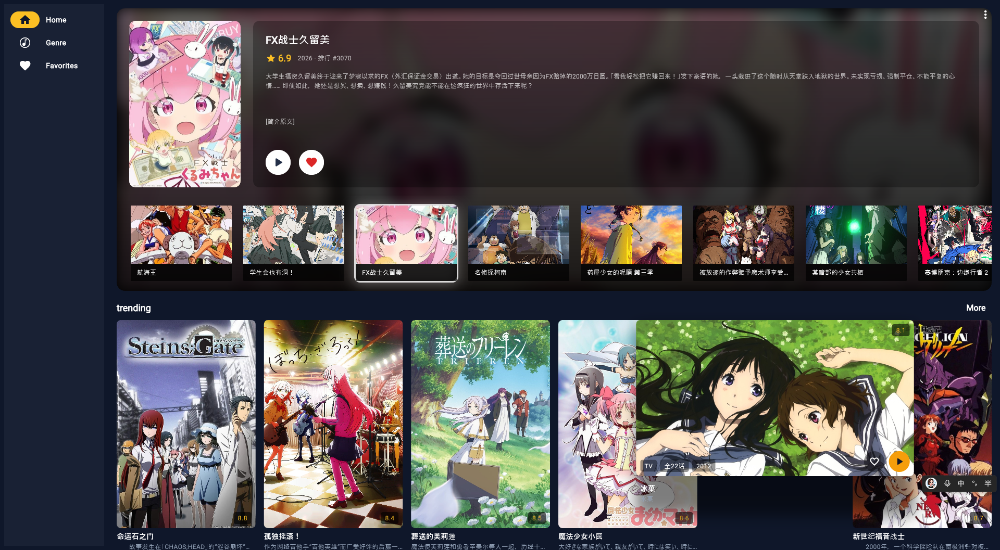

# Tiara（Movies / Anime）

Flutter 跨端动漫发现与播放应用：首页轮播、分类检索、详情收藏、规则源选片播放。数据主源为 **Bangumi**，宽幅横幅 / PV 由 **AniList** 按需补充。



## 功能概览

### 发现
- 首页：本季放送轮播、Trending / Popular / Top Rated 网格；悬停（桌面）扩到 2 列横幅
- Genre：标签筛选与排序
- Favorites：本地持久化收藏（Drift / SQLite）

### 详情
- 海报与信息栏、章节 / 标签、角色与声优
- 预告缩略图，一键进播放页
- 收藏按钮（本地持久化）

### 播放与取流
- **正片（规则源）**
  - 支持导入 Kazumi 规则（单条 JSON / JSON 数组 / 多行 / `kazumi://` 链接）
  - 选源面板：多规则并行搜索，展示各源状态与结果
  - 线路 / 分集解析，跨集切换
  - 无头 WebView（Windows）钩页面里的 m3u8 / mp4 直链，交给 `media_kit` 播放
  - 按规则携带 UA / Referer 请求头
- **预告片 / PV（YouTube）**
  - `youtube_explode_dart` 解析 YouTube 直链并播放（下载 / 取流支持）
  - 与正片播放闭环同一套 `VideoPage`
- 系统代理：WebView2 走系统代理；`youtube_explode` / mpv 可按需接管

### 平台
- 自适应导航：小屏底部栏，中大屏 NavigationRail（`flutter_adaptive_scaffold`）
- 桌面：窗口最小 700×600（`desktop_window`）
- Web：`sqlite3.wasm` + `drift_worker.js`，收藏可跨刷新保留
- 启动图标：`flutter_launcher_icons` 从 `assets/icon/app_icon.png` 生成（产物不入库）

## 参考与致谢

开发过程中借鉴 / 依赖了以下项目，在此致谢：

> **Mastering Flutter: Learn to develop Flutter apps for iOS, Android, desktop and web**  
> — Kevin Moore

书中以 TMDB 电影应用为例的工程实践（数据库分层、自适应布局、桌面窗口限制、Web + Drift 等），在本项目里改编为 Bangumi / AniList 动漫场景。

> **[flutter-webview-windows](https://github.com/jnschulze/flutter-webview-windows)**  
> Windows 无头 WebView 能力。本项目用它在页面内拦截 / 提取正片 m3u8、mp4 直链，再交给 `media_kit` 播放。

> **[youtube_explode_dart](https://github.com/Hexer10/youtube_explode_dart)**  
> YouTube 流解析。预告片 / PV 的下载与取流支持基于该库，绕过 blob/MSE，拿到可播放直链。

## 技术栈

- **Flutter**（Dart SDK `^3.13.2`）
- 状态与路由：`flutter_riverpod`、`auto_route`
- 网络：`dio`（Bangumi REST + AniList GraphQL）
- 规则引擎：自研 Rule Engine（搜索 / 线路 / 分集），兼容 Kazumi 规则 JSON
- 取流与播放：
  - `webview_windows`（无头取正片直链，Windows）
  - `youtube_explode_dart`（YouTube PV 直链）
  - `media_kit` / `media_kit_video`（统一播放器）
- 本地存储：`drift` / `drift_flutter`（收藏、标签、规则）；`shared_preferences`（缓存）
- UI：`cached_network_image`、`google_fonts`、`card_swiper`；主题「追番琥珀」
- 自适应：`flutter_adaptive_scaffold`、`desktop_window`
- 图标：`flutter_launcher_icons`

## 项目结构

```text
lib/
├── main.dart                    # 入口（桌面窗口尺寸、日志、代理）
├── providers.dart               # Riverpod：API / DB / ViewModel
├── data/
│   ├── models/                  # Anime、AnimeDetails、PlayContext、SourceRule…
│   └── database/
│       ├── models/              # DBFavorite、DBAnimeGenre、Rules…
│       └── drift/               # Drift 表与实现
├── network/
│   ├── bangumi_api_service.dart
│   ├── anilist_api_service.dart
│   └── rule_engine.dart         # 规则搜索 / 线路 / 分集
├── services/video_source/       # WebView 取流、YouTube 取流
├── router/                      # auto_route 路由
└── ui/
    ├── theme/theme.dart         # 追番琥珀色板与 ThemeData
    ├── main_screen.dart         # AdaptiveLayout 三槽位导航
    ├── screens/                 # home / genres / favorites / detail / source_sheet / videos
    └── widgets/                 # 卡片、收藏行、演员条…
```

## 跑起来

环境：Flutter SDK（Dart `^3.13.2`），目标平台任选（Windows / macOS / Linux / Android / iOS / Web）。

```bash
flutter pub get
dart run tool/sync_web_assets.dart   # 同步 Web 端 Drift 资源到 web/

flutter run                 # 默认设备
flutter run -d chrome       # Web
flutter run -d windows      # 桌面（正片 WebView 取流主要在 Windows 验证）
flutter run -d android
```

生成各平台启动图标（可选）：

```bash
dart run flutter_launcher_icons
```

改 Drift 表结构后如需重新生成代码：

```bash
flutter pub run build_runner build
```

### Web 说明

Web 端 Drift 依赖两个静态资源：

- `web/sqlite3.wasm` — 浏览器里的 SQLite（WASM）
- `web/drift_worker.js` — Drift 后台 worker

从 pub 缓存同步（`pub get` 后执行一次，升级 `drift` 后建议再跑）：

```bash
dart run tool/sync_web_assets.dart
```

`AnimeDatabase` 通过 `driftDatabase` + `DriftWebOptions` 自动切换原生 / Web。

### Windows 注意 ⚠️

使用插件时需开启「开发人员模式」，否则可能报 symlink 相关错误：

`Win + I` → 搜索「开发者设置」→ 打开「开发人员模式」。

无头 WebView 取流依赖 WebView2 运行时（Windows 10/11 一般自带）。

## 规则源播放（简要）

1. 详情页或源面板 **Import**，粘贴 Kazumi 规则（JSON / 数组 / 多行 / `kazumi://`）
2. 打开选源面板：对已导入规则并行 `search`
3. 点结果 → `queryChapters` 拿线路与分集 → 生成 `PlayContext`
4. 播放页：无头 WebView 打开分集页，钩 m3u8/mp4，交给 `media_kit`
5. 可切换线路 / 分集；UA、Referer 按规则附带

更细的教程见 `docs/Phase1` … `Phase5` 与《规则源播放改造方案》。

## 已实现 / 待实现

- [x] 主框架（自适应导航：Home / Genre / Favorites）
- [x] 首页轮播 + 多分类网格
- [x] Bangumi 搜索 / 日历 / 详情 / 角色
- [x] AniList 横幅与 PV 补充
- [x] Drift 收藏与标签持久化
- [x] 详情页（信息布局、预告、收藏按钮）
- [x] 规则导入与管理（Kazumi JSON / 链接）
- [x] 选源面板多源并行搜索
- [x] 线路 / 分集解析与跨集切换
- [x] 无头 WebView 取正片直链 → media_kit 播放
- [x] YouTube 预告 / PV：youtube_explode 取流播放
- [x] 系统代理读取与 mpv http-proxy 透出
- [x] 追番琥珀主题（dark ColorScheme + 统一 token）
- [x] 应用名 Tiara + launcher icons 流水线
- [x] Web / 桌面基础适配
- [ ] 正片流下载 / 离线缓存
- [ ] 评论 BBCode 富文本（可参考 Kazumi 的 ANTLR 方案）
- [ ] 图片按分辨率动态取图
- [ ] 搜索页体验完善

## License

MIT
